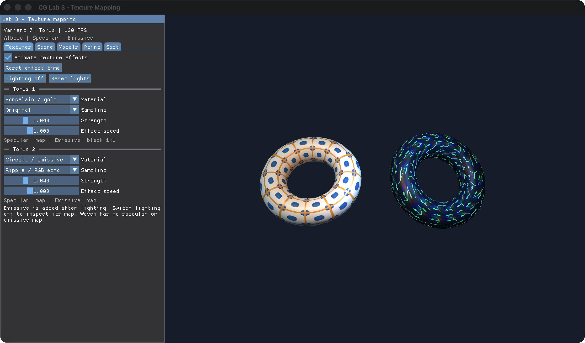
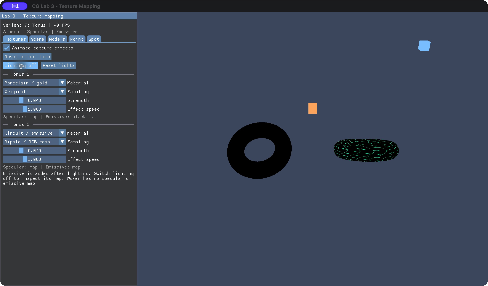

# Лабораторная работа №3 — текстурирование

Вариант 7: тор. Продолжение сцены второй лабораторной на C++20, Vulkan,
GLFW и ImGui. Реализованы базовое задание и дополнительные пункты 1–3.



## Сборка и запуск

На macOS с установленным Vulkan SDK:

```sh
./lab3/run-macos.sh
```

Скрипт использует SDK `~/VulkanSDK/1.4.321.0`; другой путь можно указать
переменной `CG_VULKAN_SDK_ROOT`. CMake загружает GLFW, vk-bootstrap, VMA и ImGui.
`stb_image` для декодирования изображений включён в `third_party` вместе с лицензией.

Общие команды из корня репозитория, после настройки окружения Vulkan SDK:

```sh
cmake -S . -B build-debug -DCMAKE_BUILD_TYPE=Debug
cmake --build build-debug --parallel
ctest --test-dir build-debug --output-on-failure
./build-debug/lab3/cg-lab3
```

Для Windows/Linux нужны CMake 3.20+, компилятор C++20 и Vulkan SDK с `glslc`.
Графический запуск проверен на macOS/MoltenVK; другие платформы не проверялись.
Пути к шейдерам и текстурам задаются при сборке, поэтому запуск не зависит
от текущего рабочего каталога. Каталог изображений можно переопределить
переменной `CG_TEXTURE_DIR`; имена файлов перечислены в `textures/README.md`.
Отсутствующий или повреждённый обязательный файл вызывает сообщение об ошибке
и завершение с ненулевым кодом.

## Управление

- **Textures:** отдельный выбор материала и эффекта для каждого тора;
  сила и скорость эффекта, общая пауза анимации и сброс её времени.
- **Original:** одна выборка без искажения. **Ripple / RGB echo:** волна в UV,
  три выборки изображения со сдвигом цветовых каналов и модуляция цвета.
  **Wobble / box blur:** деформация UV и свёртка 3×3 того же изображения.
  Оба эффекта зависят от времени.
- **Lighting off / Reset lights:** выключение всех источников / восстановление.
  Без света видна только emissive-карта материала Circuit.
- **Scene:** камера, проекция, ambient, направленный свет, маркеры и конусы.
- **Models:** положение, поворот, масштаб, оттенок текстуры, параметры блика
  и анимация траектории каждого объекта.
- **Point / Spot:** добавление, удаление и параметры источников света.
- Правая кнопка мыши над сценой: обзор мышью; **WASD** — движение,
  **Q/E** — вниз/вверх.

Материалы: Porcelain с золотыми швами и specular-маской; Circuit с отдельными
specular/emissive-картами; Woven без дополнительных карт. Можно назначить
один материал обоим объектам: их преобразования и эффекты остаются независимыми.

## Как выполнено задание

| Требование | Реализация |
| --- | --- |
| Изображения из файловой системы | `gpu_resources.cpp::loadTexture`: `stbi_load`, RGBA8, staging, `VkImage`, `VkImageView` |
| UV в вершинах | `torus.cpp::generateTorus`: `u=i/N`, `v=j/M`; на обоих швах вершины дублируются с UV 0 и 1 |
| Геометрия в памяти GPU | `uploadGeometry`: `DEVICE_LOCAL`, `TRANSFER_DST`, `vkCmdCopyBuffer`, барьер до чтения вершин/индексов |
| Один dynamic UBO | `scene.cpp::updateUniforms`: общий `model_uniform` для торов, маркеров и конусов; отдельные выровненные слоты |
| Выбор модели при привязке | `scene.cpp::render`, `bindModel`: один dynamic offset в `vkCmdBindDescriptorSets` |
| Набор дескрипторов на материал | `createDescriptors`: общий dynamic UBO и три пары image/sampler, отдельный set для каждого материала |
| Эффекты через push constants | `SamplingData`: тип эффекта, время, сила, скорость; 16 байт, только fragment stage |
| Блики по specular-карте | `torus.frag::blinnPhong`: specular-маска умножает только зеркальную составляющую |
| Emissive после освещения | `torus.frag::main`: выборка карты прибавляется после ambient и всех источников |
| Отсутствующие карты | Общая чёрная текстура `black.png`, 1×1; соответствующие вклады равны нулю |

### Dynamic UBO

`UniformData` занимает 96 байт: `mat4 model`, `vec4 albedo` (оттенок),
`vec4 specularShininess`. Смещения C++ проверяются `static_assert`;
шейдеры используют одинаковое объявление из `model.glsl` с `std140`.

Шаг между слотами вычисляется по лимиту физического устройства:

```text
stride = ceil(sizeof(UniformData) / alignment) * alignment
alignment = minUniformBufferOffsetAlignment
dynamicOffset = modelIndex * stride
```

В дескрипторе `offset=0`, `range=sizeof(UniformData)`: адресуется одна модель,
а не весь массив. При росте количества маркеров общий буфер увеличивается,
после чего ссылки на него обновляются во всех материалах. Запись выполняется
после ожидания fence предыдущего кадра. На проверенном устройстве шаг равен
96 байтам; тест также проверяет выравнивание 256 байт, при котором шаг больше структуры.

### Копирование и синхронизация

Для постоянной геометрии используется путь RAM → staging → GPU buffer.
Текстуры проходят переходы `UNDEFINED → TRANSFER_DST_OPTIMAL → SHADER_READ_ONLY_OPTIMAL`.
Staging освобождается только после fence копирования. Изменяемые линии конусов
тоже копируются из staging в device-local buffer перед render pass, с барьером
`TRANSFER_WRITE → VERTEX_ATTRIBUTE_READ`.

На Apple Silicon память физически общая; здесь device-local означает выбранный
тип памяти Vulkan и загрузку через команды GPU, а не обещание отдельной VRAM.
Текстуры используют один mip-уровень, линейную фильтрацию и адресацию Repeat.
Цветовые карты читаются как sRGB, specular — как линейные маски.
Emissive создаёт свечение поверхности и не освещает соседние объекты.

Зависимость `VK_SUBPASS_EXTERNAL → 0` связывает ожидание acquire-семафора
с автоматическим переходом swapchain image в layout цветового attachment.
Она также учитывает запись и чтение общего depth attachment.

## Проверки

На macOS/MoltenVK выполнены:

- сборка всего проекта и компиляция четырёх GLSL-шейдеров;
- 6 CTest-тестов, включая геометрию/освещение предыдущих работ и новый тест
  UV-швов и выравнивания dynamic UBO;
- проверка четырёх SPIR-V модулей через `spirv-val --target-env vulkan1.1`;
- 150 кадров с изменением размера окна, очисткой и ростом до 65 point/25 spot,
  показом маркеров и конусов, сменой проекции, всеми материалами и эффектами;
- тот же графический прогон с synchronization validation: ошибок нет;
- отсутствие файлов текстур: понятная ошибка, код завершения 1;
- визуальная проверка текстур, общего материала у двух объектов и emissive без света.

Воспроизводимый графический прогон после настройки SDK:

```sh
VK_LAYER_ENABLES=VK_VALIDATION_FEATURE_ENABLE_SYNCHRONIZATION_VALIDATION_EXT \
CG_SMOKE_RESIZE=1 CG_SMOKE_LIGHTS=1 CG_SMOKE_TEXTURES=1 \
./build-debug/lab3/cg-lab3
```

При изменении размера окна драйвер может вернуть `VK_SUBOPTIMAL_KHR`;
программа пересоздаёт swapchain. Это сообщение не является ошибкой validation.



Для разбора кода: `main.cpp` — цикл приложения, `graphics_internal.cpp` —
устройство/swapchain/render passes, `gpu_resources.cpp` — загрузка ресурсов,
`scene.cpp` — дескрипторы, данные сцены, UI и команды рисования,
`torus.cpp` — геометрия и UV, `torus.frag` — выборки и освещение.

Справка по dynamic offset:
[Vulkan Guide](https://docs.vulkan.org/guide/latest/descriptor_dynamic_offset.html).
