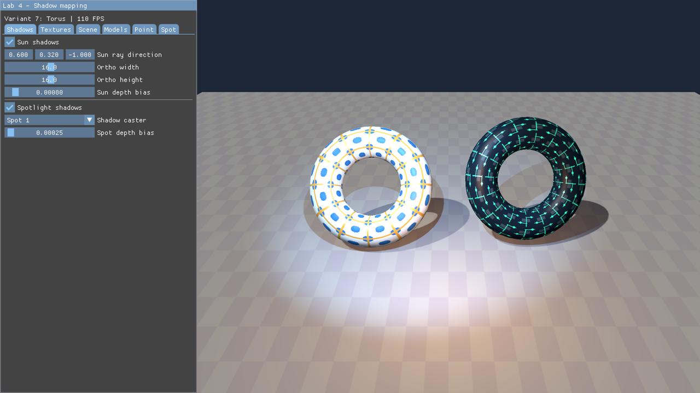

# Лабораторная работа № 4 — наложение теней

Вариант 7, тор. Два текстурированных тора отбрасывают тени на пол и затеняют собственную поверхность. Выполнены базовое задание с направленным источником и дополнительное задание с одним выбираемым прожектором.



## Сборка и запуск

На macOS с Vulkan SDK и MoltenVK запустите из корня репозитория:

```sh
./lab4/run-macos.sh
```

Скрипт использует SDK `~/VulkanSDK/1.4.321.0`. Путь можно переопределить переменной `CG_VULKAN_SDK_ROOT`.

Для сборки с настроенным Vulkan SDK нужны CMake 3.20+, компилятор C++20, `glslc` и устройство с поддержкой Vulkan 1.3 и `dynamicRendering`. Работа использует геометрию тора, текстуры и инфраструктуру окна и Vulkan из [ЛР № 3](../lab3/).

```sh
cmake -S . -B build-debug -DCMAKE_BUILD_TYPE=Debug
cmake --build build-debug --target cg-lab4 --parallel
./build-debug/lab4/cg-lab4
```

## Управление

- **Shadows** — отдельно включить применение теней от солнца и прожектора. `Ortho width` и `Ortho height` меняют размеры области карты солнца в единицах сцены. `Sun depth bias` и `Spot depth bias` задают смещение сравниваемой глубины.
- **Shadow caster** — прожектор, для которого строится карта. Положение, направление и угол его конуса задаются во вкладке **Spot**.
- **Scene** — камера и параметры света. **Models** — положение, поворот, масштаб и движение торов. **Textures** — материалы и эффекты из предыдущей работы.
- Зажмите правую кнопку мыши над сценой для обзора. **WASD** перемещают камеру, **Q/E** опускают и поднимают её.

[Снимок с тенью солнца](docs/sun-shadow.png) · [Снимок с тенью прожектора](docs/spot-shadow.png). В обоих кадрах светят оба источника, а переключатели выключают применение одной из карт.

## Как строится тень

1. В `updateUniforms` ([scene.cpp](source/scene.cpp)) вычисляем матрицу вида источника через `lookAt`. Для солнца берём ортографическую проекцию, потому что его лучи параллельны. Для прожектора берём перспективную проекцию с углом обзора, равным удвоенному внешнему полууглу конуса.
2. Каждый кадр до основного прохода записываем глубины с точки зрения солнца. В [shadow_maps.cpp](source/shadow_maps.cpp) передаём depth image размером 2048×2048 в `vkCmdBeginRendering`. У прохода только depth attachment, у конвейера только вершинный [shadow.vert](shaders/shadow.vert). Тест глубины оставляет в каждом текселе ближайшую к источнику поверхность. Для выбранного прожектора повторяем проход с другой матрицей и другой картой.
3. Барьер после `vkCmdEndRendering` переводит изображение из `DEPTH_STENCIL_ATTACHMENT_OPTIMAL` в `DEPTH_STENCIL_READ_ONLY_OPTIMAL` и делает результат записи глубины доступным фрагментному шейдеру. Перед следующим проходом глубины карта возвращается в режим записи.
4. В [torus.frag](shaders/torus.frag) проектируем мировую точку в систему источника и делим координаты на `w`. Из `x` и `y` получаем UV карты, а `z` уже лежит в диапазоне глубины Vulkan `[0, 1]`. `sampler2DShadow` сравнивает `z - bias` с глубиной из карты оператором `LESS`. Меньшая глубина означает, что точка видна источнику. Усредняем девять результатов сравнения, чтобы смягчить ступеньки на краю тени.
5. Видимость умножается на диффузный и зеркальный вклад соответствующего источника. Ambient, emissive и вклад других источников по-прежнему складываются в итоговый цвет.

Depth bias компенсирует погрешности при сравнении поверхности с её собственной глубиной. Малый bias даёт полосы самозатенения, слишком большой визуально отрывает тень от объекта. За пределами карты шейдер считает точку освещённой. Если увеличить охват карты солнца при том же разрешении, один тексель покроет больший участок сцены и края тени станут грубее.

Сэмплер сравнения закреплён в layout дескрипторов через `pImmutableSamplers` для совместимости с MoltenVK. Привязка изображения по-прежнему задаётся через его `VkImageView`. [Vulkan Guide о переходе от записи глубины к чтению](https://docs.vulkan.org/guide/latest/synchronization_examples.html#_first_draw_writes_to_a_depth_attachment_second_draw_samples_from_that_depth_image_in_the_fragment_shader_e_g_shadow_map_rendering)

## Проверка

На macOS, Apple M4 и MoltenVK 1.3.0 собран весь проект, прошли 6 тестов CTest и проверка 5 SPIR-V модулей. Графический прогон на 150 кадров с synchronization validation прошёл без ошибок. В прогоне переключались карты, менялись размер окна и область проекции, выбирался второй прожектор, проверялись пустой список прожекторов, вертикальное направление солнца и движение тора.

```sh
VK_LAYER_ENABLES=VK_VALIDATION_FEATURE_ENABLE_SYNCHRONIZATION_VALIDATION_EXT \
CG_SMOKE_RESIZE=1 CG_SMOKE_SHADOWS=1 ./lab4/run-macos.sh
```
